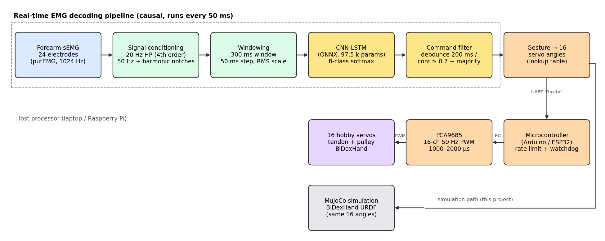
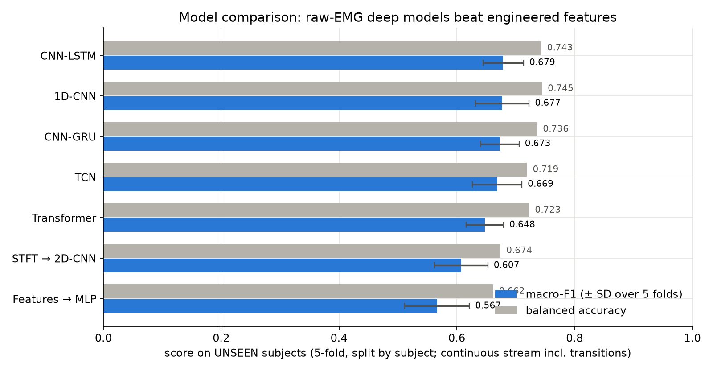
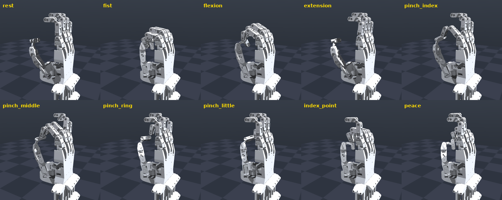
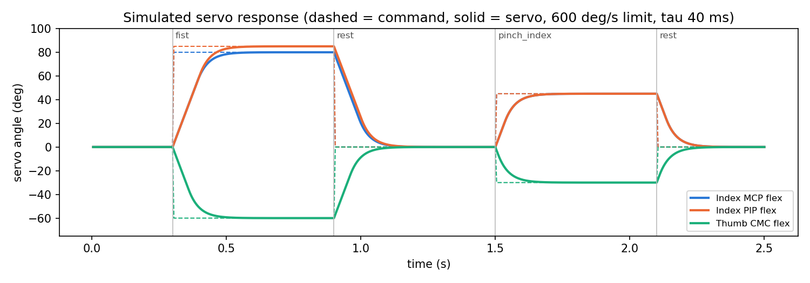
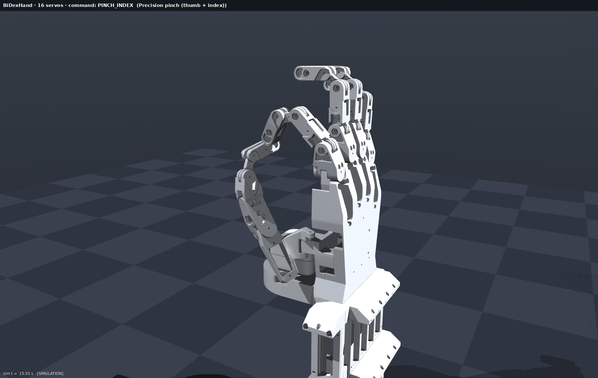
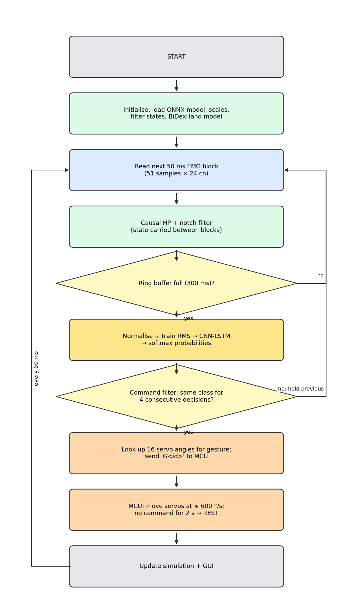
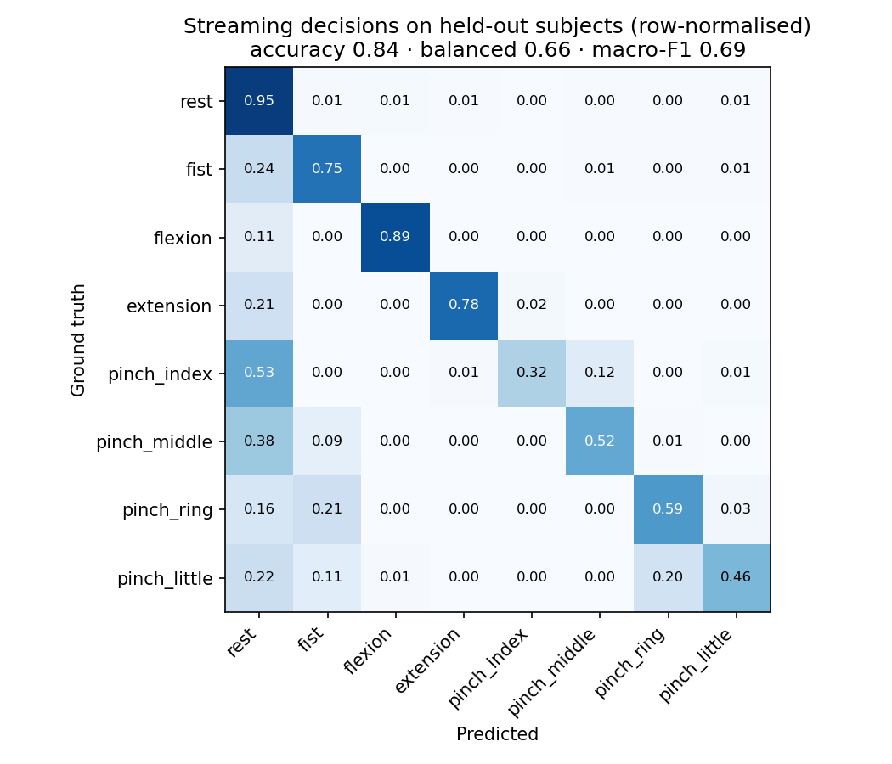
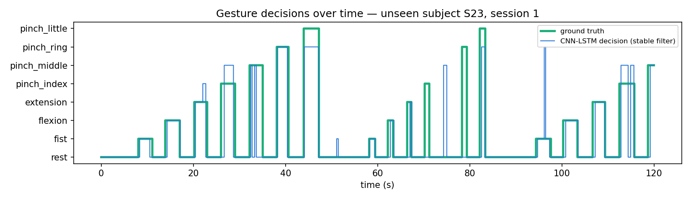

# EMG-Controlled Dexterous Robotic Hand: Real-Time Gesture Recognition with a CNN-LSTM and a Microcontroller-Driven 16-Servo Hand Simulation

**Microcontroller Project Report**

Submitted by: **[Student Name] — [Roll No.]**

Under the guidance of: **[Guide Name], [Designation]**

**Department of [Electronics / E&TC / Computer Engineering]**
**[College Name], [University]**
Academic Year 2026–27

<!-- pagebreak -->

## Certificate

This is to certify that the project report entitled **"EMG-Controlled Dexterous Robotic Hand: Real-Time Gesture Recognition with a CNN-LSTM and a Microcontroller-Driven 16-Servo Hand Simulation"** submitted by **[Student Name] ([Roll No.])** is a bonafide record of the work carried out by them under my supervision, in partial fulfilment of the requirements of the course **Microcontroller [and Applications] Project** of **[University]** during the academic year 2026–27.

&nbsp;

| | |
|---|---|
| **[Guide Name]** | **[Head of Department]** |
| Project Guide | Head of Department |
| Date: | Place: |

<!-- pagebreak -->

## Acknowledgement

I would like to express my sincere gratitude to my project guide **[Guide Name]** for continuous guidance, encouragement and technical advice throughout this project. I thank **[Head of Department]**, Head of the Department, and the faculty and staff of the Department of [Department] for providing the facilities required for this work.

I also acknowledge the authors of the open resources this project builds on: the **putEMG** dataset (Poznań University of Technology), the **BiDexHand** open-source robotic hand (Z. K. Weng), and the open-source **MuJoCo**, **ONNX Runtime**, **SciPy** and **ROS 2** projects.

Finally, I thank my family and friends for their support.

**[Student Name]**

<!-- pagebreak -->

## Abstract

Myoelectric prostheses let an amputee control an artificial hand with the electrical activity of the remaining forearm muscles (surface electromyography, sEMG). Most commercial devices still use one or two electrodes and simple thresholds, which gives only open/close control. This project builds a complete, real-time pipeline from multi-channel sEMG to a 16-servo dexterous robotic hand, organised the way a microcontroller-based prosthesis would be.

Two earlier prototypes were merged. The first (EMG Hand V1) provided the **BiDexHand** 16-servo hand model and a ROS 2/RViz visualisation, but used a 3-class 1D-CNN that reached only **51 %** cross-subject accuracy. The second (EMG Prosthetic Hand) provided a much stronger **CNN-LSTM** classifier trained on the putEMG dataset (24 channels, 8 gestures). In this project the CNN-LSTM drives the BiDexHand: a causal filter (20 Hz high-pass, 50 Hz notches) and a 300 ms sliding window feed the network every 50 ms; a debounce filter stabilises the decision; each gesture is mapped to 16 servo angles and PWM pulse widths, exactly as the microcontroller firmware (Arduino/ESP32 + PCA9685) would output them. The hand is simulated in **MuJoCo** from the original URDF, with a speed-limited servo model, and an interactive GUI shows the EMG, class probabilities, ground truth and all 16 servo channels. The same GUI can stream the decisions to the real servo controller over UART.

On four subjects never used for training (8 recordings, 42 224 streaming decisions, transitions included) the system reaches **84.5 % accuracy, 0.66 balanced accuracy and 0.69 macro-F1 over 8 classes**, with **0.46 ms** inference per decision on one CPU core — well inside the 50 ms control period.

**Keywords:** surface EMG, myoelectric control, CNN-LSTM, prosthetic hand, PCA9685, servo control, MuJoCo, embedded machine learning.

<!-- pagebreak -->

## Table of Contents

- Certificate
- Acknowledgement
- Abstract
- List of Figures
- List of Tables
- 1. Introduction
- 2. Problem Statement
- 3. Objectives
- 4. Literature Survey / Existing System
- 5. Proposed System / Methodology
- 6. System Architecture / Block Diagram
- 7. Hardware and Software Requirements
- 8. System Design / Implementation
- 9. Working / Algorithm / Flowchart
- 10. Results and Discussion
- 11. Advantages and Applications
- 12. Limitations
- 13. Future Scope
- 14. Conclusion
- References
- Appendix

<!-- pagebreak -->

## List of Figures

| Fig. | Title |
|---|---|
| 1 | System block diagram |
| 2 | Program flowchart of the real-time control loop |
| 3 | BiDexHand simulation: the ten gesture poses |
| 4 | Simulation window frame in ML mode |
| 5 | Simulated servo response to gesture commands |
| 6 | Model comparison on unseen subjects (putEMG, 5-fold) |
| 7 | Streaming confusion matrix on held-out subjects |
| 8 | Gesture decisions over time for an unseen subject |

## List of Tables

| Table | Title |
|---|---|
| 1 | Comparison of the two earlier prototypes |
| 2 | Hardware requirements |
| 3 | Software requirements |
| 4 | Gesture → hand function → servo command |
| 5 | Serial protocol between host and microcontroller |
| 6 | Results on held-out subjects |
| 7 | Per-class recall and F1 |
| 8 | Timing budget |

<!-- pagebreak -->

## 1. Introduction

Losing a hand removes the most versatile tool a person has. An upper-limb prosthesis can restore part of that function, and the most natural way to command it is with the user's own muscle signals. When a forearm muscle contracts, its motor units fire action potentials that can be picked up on the skin as **surface electromyography (sEMG)** — a signal of a few microvolts to a few millivolts with useful energy between about 20 Hz and 450 Hz. Different hand gestures activate different combinations of forearm muscles, so the spatial and temporal pattern across several electrodes carries information about the intended gesture.

A myoelectric hand therefore needs three things:

1. **Sensing and conditioning** — amplify, filter and sample the EMG from several electrodes.
2. **Decoding** — turn a short window of EMG into a gesture decision quickly and reliably (a delay above roughly 100–125 ms is noticed by users).
3. **Actuation** — a microcontroller turns the decision into motor or servo commands that move the fingers safely.

This project implements all three stages in software around a real dexterous hand design (BiDexHand, 16 servo-driven joints) and a real public EMG dataset (putEMG), with the hand simulated in MuJoCo. The microcontroller part (servo PWM generation, rate limiting, fail-safe watchdog, serial protocol) is written as Arduino/ESP32 firmware and reproduced exactly in the simulation, so the same commands can drive the physical servo board.

## 2. Problem Statement

To design and simulate a **real-time, EMG-controlled multi-gesture robotic hand** in which:

- multi-channel forearm sEMG is classified into functional hand gestures by a machine-learning model that generalises to **people it was not trained on**;
- every decision is made causally (only from past samples) within a fixed control period;
- the decision is converted into commands for a **16-servo dexterous hand** by a microcontroller, with safe, rate-limited motion; and
- the complete chain can be demonstrated and verified in simulation before hardware is built.

The previous prototype of this hand reached only 51 % accuracy on three gestures, which is not usable for control. The task was to replace its classifier with the better model from the second prototype and build a proper simulation around the hand.

## 3. Objectives

1. Integrate the **CNN-LSTM** classifier (8 gestures, 24 channels) from the EMG Prosthetic Hand project with the **BiDexHand** model from the EMG Hand project.
2. Build a **causal streaming pipeline**: filtering, 300 ms windowing, inference every 50 ms, and a command filter that suppresses flicker.
3. Map each gesture to **16 servo angles** using the hand's real joint mapping (including the PIP→DIP linkage), and generate the corresponding **PWM pulse widths**.
4. Build a **MuJoCo simulation** of the hand with a realistic servo model, and an interactive GUI with ML and manual modes.
5. Write **microcontroller firmware** (Arduino/ESP32 + PCA9685) that receives gesture commands over UART and drives the 16 servos with rate limiting and a watchdog.
6. **Evaluate** the full chain on held-out subjects and measure the timing budget.

## 4. Literature Survey / Existing System

**Classical myoelectric control.** Commercial prostheses commonly use two electrodes on an antagonist muscle pair; the amplitude of each opens or closes the hand, and co-contraction switches grip modes. This is robust but slow and unintuitive for more than one grip. Hudgins et al. (1993) introduced pattern recognition on short EMG windows using time-domain features (mean absolute value, zero crossings, slope sign changes, waveform length), which remains the classical baseline (e.g. with LDA). Englehart and Hudgins (2003) showed continuous classification with overlapping windows, the scheme used here.

**Controller delay.** Farrell and Weir (2007) found that the optimal controller delay for myoelectric prostheses is about 100–125 ms; longer delays degrade performance. This sets the window and decision budget (300 ms window, 50 ms step, ≈ 0.2 s onset with debouncing).

**Deep learning on EMG.** Convolutional and recurrent networks learn features directly from the filtered signal. CNN-LSTM hybrids combine local spatial-temporal filters with a recurrent summary over the window. Cross-subject generalisation remains the main difficulty, because electrode position, skin and anatomy differ between people.

**Datasets.** putEMG (Kaczmarek et al., 2019) provides 44 subjects × 2 sessions of 24-channel EMG (3 × 8 armband grid) at 5120 Hz with 8 gestures performed continuously, including wrist flexion/extension and four thumb pinches. Its continuous recordings make it suitable for testing a streaming decoder including transitions.

**Dexterous hands.** BiDexHand (Weng, 2025) is an open-source 16-DoF biomimetic hand driven by hobby servos through tendons and pulleys, with four-bar linkages coupling each DIP to its PIP joint, and a ROS 2 interface taking 16 servo angles.

**Existing system (our prototypes).** Table 1 summarises the two prototypes merged in this project.

**Table 1 — Comparison of the two earlier prototypes**

| | EMG Hand V1 | EMG Prosthetic Hand | **This project** |
|---|---|---|---|
| Hand model | BiDexHand, 16 servos (URDF, ROS 2/RViz) | 6-tendon DC-motor hand (MuJoCo) | **BiDexHand, 16 servos (MuJoCo)** |
| Classifier | 1D-CNN, 4 channels | CNN-LSTM, 24 channels | **CNN-LSTM, 24 channels** |
| Gestures | 3 (pinch, fist, open) + RMS rest | 8 incl. rest | **8 + 2 manual presets** |
| Cross-subject result | 51 % accuracy (3 classes) | 0.69 macro-F1 (8 classes) | **0.69 macro-F1, 84.5 % acc.** |
| Microcontroller output | ROS topic only | motor current model | **PWM table + Arduino firmware + UART link** |

## 5. Proposed System / Methodology

The proposed system keeps the stronger decoder and the more dexterous hand:

1. **Signal acquisition (dataset replay).** Continuous putEMG recordings (24 channels) are down-sampled to 1024 Hz and streamed to the decoder in 50 ms blocks (51 samples), exactly as an ADC front-end would deliver them. Only recordings of four subjects that were never used for training or validation (S23, S30, S31, S34) are used for the demonstration and evaluation.
2. **Pre-processing.** A 4th-order Butterworth high-pass at 20 Hz removes motion artefacts and DC; IIR notch filters (Q = 30) at 50 Hz and its harmonics remove mains interference. All filters are causal second-order sections whose state is carried from block to block, so streaming output is identical to offline filtering.
3. **Windowing and normalisation.** A ring buffer holds the latest 300 ms (307 samples × 24 channels). Each channel is divided by its training-set RMS.
4. **Classification.** A CNN-LSTM (97 544 parameters, 3.7 M multiply-accumulates per decision) outputs probabilities for 8 classes: rest, fist, wrist flexion, wrist extension, and thumb–index/middle/ring/little pinch. It is exported to ONNX and run with ONNX Runtime on one CPU thread.
5. **Command filter.** Three options are provided: *Responsive* (raw argmax), *Stable* (switch only after 4 consecutive equal decisions = 200 ms, default) and *Safe* (confidence ≥ 0.7 plus 7-vote majority, otherwise rest).
6. **Gesture → servo mapping.** Each class is mapped to a hand function and a 16-angle servo command (Table 4). Pinch poses were obtained by numerically solving (Nelder–Mead) for the thumb angles that bring the thumb tip to the target fingertip in the hand model.
7. **Microcontroller.** The firmware receives `G<id>` over UART, looks up the 16 angles, moves every servo towards its target at ≤ 600 °/s, and writes 1000–2000 µs pulses through a PCA9685 at 50 Hz. A 2 s watchdog relaxes the hand if the host stops sending.
8. **Simulation.** The 16 servo angles are converted to the 21 URDF joint angles with the hand's own mapping (PIP compensation and DIP-from-PIP antiparallelogram linkage) and rendered in MuJoCo.

## 6. System Architecture / Block Diagram



The host processor (laptop now, Raspberry Pi in a wearable version) runs the decoding pipeline. The microcontroller is responsible for everything time-critical on the actuator side: PWM generation, speed limiting and the fail-safe. In this project the microcontroller output is reproduced in the simulation; with `--serial` the same commands go to a physical board.

## 7. Hardware and Software Requirements

**Table 2 — Hardware requirements**

| Component | Specification | Purpose |
|---|---|---|
| Host computer | x86-64 laptop (tested: Ryzen 7 5800H, 16 GB) or Raspberry Pi 4/5 | EMG decoding, simulation, GUI |
| Microcontroller | Arduino Uno/Nano (ATmega328P) or ESP32 | Serial command parser, servo trajectory, watchdog |
| PWM driver | PCA9685, 16 channels, 12-bit, I²C | 16 × 50 Hz servo pulses |
| Servos | 16 × micro servo (SG90/MG90S class, 0.10 s/60°) | Finger joints of the BiDexHand |
| Servo power supply | 5–6 V, ≥ 5 A | Servos (separate from logic supply, common ground) |
| EMG front-end (future) | 8–24 channel sEMG amplifier/armband, ≥ 1 kHz | Live EMG instead of dataset replay |
| Hand mechanics | BiDexHand 3D-printed parts, tendons, pulleys | Physical hand (optional for this project) |

**Table 3 — Software requirements**

| Software | Version | Use |
|---|---|---|
| Ubuntu Linux | 24.04+ | Development OS |
| Python | 3.10+ | Pipeline, simulation, GUI |
| MuJoCo | 3.x | Hand kinematics and rendering |
| ONNX Runtime | 1.17+ | CNN-LSTM inference |
| NumPy / SciPy | — | Signal processing (causal IIR filters) |
| Tkinter, Pillow, Matplotlib | — | GUI and figures |
| pyserial | 3.5 | UART link to the microcontroller |
| Arduino IDE + Adafruit PWM Servo Driver library | 2.x | Firmware |
| ROS 2 + RViz (optional) | — | Original V1 visualisation |

## 8. System Design / Implementation

### 8.1 Software structure

| File | Role |
|---|---|
| `simulation/app.py` | GUI: ML/manual modes, EMG envelope, probabilities, ground truth, 16-servo panel, `--serial` link, `--selftest` |
| `simulation/emg_sim/emg_runtime/signal.py` | Causal filter design and streaming filter with persistent state |
| `simulation/emg_sim/emg_runtime/realtime.py` | Ring buffer, normalisation, inference call, command filters |
| `simulation/emg_sim/bidexhand.py` | URDF → MuJoCo model, gesture table, servo model, 16→21 joint mapping, PWM conversion |
| `simulation/model/` | `cnn_lstm.onnx` and `deploy.json` (scales, filter settings, class names) |
| `simulation/make_figures.py` | Offline evaluation of the streaming decoder and report figures |
| `firmware/emg_hand_servo/emg_hand_servo.ino` | Microcontroller firmware |

### 8.2 The CNN-LSTM model

Input: 307 samples × 24 channels. Convolutional layers extract local temporal patterns across channels and reduce the time resolution; an LSTM summarises the resulting sequence; a dense layer produces 8 logits. The model was trained on 34 subjects with 6 validation subjects for early stopping; 4 subjects were held out completely. In a 5-fold subject-wise cross-validation the CNN-LSTM was the best of seven architectures (Fig. 6). The exported ONNX file is 385 kB (fp32); an int8 version is 107 kB with 99.6 % argmax agreement.



### 8.3 Gesture → servo mapping

**Table 4 — Gesture → hand function → servo command (degrees; channel order as in the firmware)**

| ID | Class / preset | Hand function | Main servo angles |
|---|---|---|---|
| 0 | rest | Open, relaxed | all 0° |
| 1 | fist | Power grasp | finger MCP 80°, PIP 85°; thumb CMC flex −60°, MCP flex 50° |
| 2 | flexion | Close hand | finger MCP/PIP 60°; thumb CMC −40° |
| 3 | extension | Open wide | fingers −5°, spread ±3–8° |
| 4 | pinch_index | Precision pinch | index 45°/45°; thumb CMC −30°, MCP −20° |
| 5 | pinch_middle | Tripod | index 45/50°, middle 50/55°; thumb CMC −40° |
| 6 | pinch_ring | Thumb–ring pinch | ring 55/60°; thumb CMC −59° |
| 7 | pinch_little | Thumb–little pinch | little 60/65°; thumb CMC −70°, MCP abd −24° |
| 8 | index_point | Point (manual) | index straight, others as fist |
| 9 | peace | "V" (manual) | index + middle straight and spread |

The servo angle θ is converted to a pulse width `t = 1500 µs + θ/90° × 1000 µs`. The PCA9685 runs at 50 Hz (20 ms frame).



### 8.4 Hand kinematics and servo model

BiDexHand has 16 servos and 21 revolute joints; each finger's DIP joint is coupled to its PIP joint by a four-bar (antiparallelogram) linkage:

`θ_DIP = 2·atan( 0.87 / (2.87 · tan((1.968 − θ_PIP)/2)) ) − 0.3978`

The simulation uses the same mapping as the original ROS 2 forwarding node, so a pose looks identical in RViz and MuJoCo. Each servo is modelled as a first-order position loop (τ = 40 ms) with a 600 °/s speed limit, integrated at 1 kHz (Fig. 5) — the same limit the firmware applies.



### 8.5 Microcontroller firmware

**Table 5 — Serial protocol (115 200 baud, 8N1, ASCII lines)**

| Direction | Message | Meaning |
|---|---|---|
| Host → MCU | `G<id>\n` | Go to gesture *id* (0–9). Sent on change and every 0.5 s as heartbeat |
| Host → MCU | `S<ch>,<deg>\n` | Set one servo (0–15) to an angle (−90…90°) — calibration/testing |
| MCU → Host | `OK <id>` | Gesture accepted |
| (internal) | watchdog | No message for 2 s → gesture 0 (rest) |

The main loop runs every 10 ms: it parses serial bytes without blocking, advances each servo by at most 6° per tick towards its target, and writes the pulse widths to the PCA9685 over I²C. Servo power is supplied separately from the logic supply to avoid brown-outs when all servos move at once.

### 8.6 User interface

The GUI (Fig. 4) shows the 3D hand (mouse-rotatable, preset camera views), the mode banner (ML or manual — so a viewer always knows whether the ML is in control), the EMG envelope of six channels, the probability of each class, the prediction with ground truth and a ✓/✗, the active command filter with its measured false-trigger rate, and the 16 servo channels with commanded vs. actual angle and pulse width.



## 9. Working / Algorithm / Flowchart



**Algorithm (host, every 50 ms):**

1. Read the next 51-sample × 24-channel EMG block.
2. Filter it with the stored filter state (high-pass 20 Hz, notches); save the new state.
3. Shift the block into the 300 ms ring buffer. If the buffer is not yet full, go to 1.
4. Divide by the per-channel training RMS; run the CNN-LSTM; apply softmax.
5. Apply the command filter: the candidate class must repeat for 4 consecutive decisions before the output changes (Stable mode).
6. Look up the 16 servo angles of the decided gesture; send `G<id>` to the microcontroller (if connected); command the simulated servos.
7. Advance the servo model by 50 ms, update the hand kinematics, render, and refresh the GUI.

**Algorithm (microcontroller, every 10 ms):**

1. Read any complete serial line; on `G<id>` load the 16 target angles and reset the watchdog timer.
2. If more than 2 s passed since the last command, set the target to rest.
3. For each servo: move the current angle towards the target by at most 600 °/s × Δt; convert to a pulse width; write to the PCA9685.

## 10. Results and Discussion

The full streaming pipeline (exactly the code used by the GUI, Stable filter) was run over all 8 recordings of the 4 held-out subjects. Every 50 ms decision was compared with the ground-truth label at that moment, **including the transitions** between gestures, which makes the numbers stricter than window-level accuracy on clean segments.

**Table 6 — Results on held-out subjects (never used in training or validation)**

| Metric | Value |
|---|---|
| Recordings / decisions | 8 / 42 224 |
| Accuracy | **84.5 %** |
| Balanced accuracy (8 classes, chance 12.5 %) | **65.8 %** |
| Macro-F1 | **0.69** |
| Per-recording accuracy | 80.7 % – 89.8 % |
| Previous V1 model (3 classes, chance 33 %) | 51.1 % accuracy, 0.51 macro-F1 |

**Table 7 — Per-class recall and F1 (streaming, Stable filter)**

| Class | Recall | F1 |
|---|---|---|
| rest | 0.95 | 0.92 |
| fist | 0.75 | 0.66 |
| wrist flexion | 0.89 | 0.84 |
| wrist extension | 0.78 | 0.83 |
| pinch index | 0.32 | 0.46 |
| pinch middle | 0.52 | 0.61 |
| pinch ring | 0.59 | 0.64 |
| pinch little | 0.46 | 0.58 |





**Discussion.**

- **The model swap solved the main weakness of V1.** On a harder task (8 classes instead of 3, continuous stream instead of isolated trials) the new decoder is far above chance, and rest — the most important class for safety — is recognised 95 % of the time.
- **Large movements are reliable, thumb pinches are not.** Fist and wrist flexion/extension involve large forearm muscles and are recognised well. The four pinches differ mainly in which finger meets the thumb; they activate small, deep muscles and are often confused with each other (Fig. 7). In Fig. 8 most errors are a pinch predicted as a neighbouring pinch, or short delays at gesture onset.
- **The command filter trades speed for stability.** On the held-out subjects the Responsive filter gives 8.1 false activations per minute, the Stable filter 2.7/min with about 0.24 s onset, and the Safe filter 1.1/min but detects fewer gestures. Stable is the default.
- **Timing is not a bottleneck.** See Table 8.

**Table 8 — Timing budget per 50 ms control period**

| Stage | Time |
|---|---|
| Streaming filter (51 samples × 24 ch) | ≈ 0.09 ms |
| CNN-LSTM inference, ONNX, 1 CPU core (mean / p99) | 0.46 ms / 0.50 ms |
| Servo model + kinematics + rendering + GUI | ≈ 10–20 ms |
| Servo travel 0 → 85° (600 °/s + τ = 40 ms) | ≈ 0.2 s |
| Estimated inference on Raspberry Pi 4 / STM32H7 (int8) | ≈ 3.7 ms / ≈ 25 ms |

The estimated time from the start of a gesture to the hand starting to move is about 0.25–0.3 s with the Stable filter (filter delay plus window filling), and the servo then needs about 0.2 s to complete the motion.

## 11. Advantages and Applications

**Advantages**

- Eight muscle-controlled gestures instead of the open/close of conventional two-electrode control.
- Works on people the model has never seen — no per-user training needed to start (calibration can still improve it).
- Fully causal and fast: < 1 ms inference, 20 decisions per second.
- Clear separation of tasks: the host decides, the microcontroller guarantees safe motion (rate limit, watchdog, defined rest state).
- Simulation-first: the whole chain can be tested, demonstrated and tuned without hardware; the same commands drive real servos.
- Low-cost actuation (hobby servos + PCA9685) and an open-source hand design.
- Transparent: ground truth, probabilities and the ML/manual mode are always visible.

**Applications**

- Upper-limb myoelectric prostheses and their training simulators.
- Rehabilitation and therapy (visual feedback of muscle activity).
- Tele-operation of robotic hands and grippers.
- Human–machine interfaces, gesture control of devices.
- Teaching embedded ML, biosignal processing and servo control.

## 12. Limitations

- **No live EMG yet.** The demonstration replays recorded putEMG data; electrodes and an amplifier were not part of this project.
- **No physical hand was built.** The firmware is written for the real board but was verified through the simulation only.
- **Kinematic simulation.** Servo dynamics are modelled, but contact forces and grasped objects are not; grip strength cannot be evaluated.
- **Thumb pinches are weak** (recall 0.32–0.59) because they are hard to separate from forearm EMG of unseen users.
- **24 channels** are needed by the model; a cheaper 8-channel armband would require retraining.
- The microcontroller does not run the neural network: an ESP32-S3 is estimated at ≈ 74 ms per inference (too slow for 50 ms); an STM32H7 with int8 (≈ 25 ms) or a Raspberry Pi is needed.
- Hobby servos have limited torque and no position feedback to the controller.

## 13. Future Scope

- Connect a real multi-channel EMG front-end (e.g. an 8–16 channel armband or ADS1299-based board) and run the pipeline live.
- Build the BiDexHand and validate the firmware and timing on hardware.
- Run the int8 model on an STM32H7 or a Raspberry Pi to make the system wearable and battery powered.
- Short user calibration (fine-tuning on one minute of the user's data), which improved next-week accuracy from 0.77 to 0.82 in the earlier study.
- Proportional control (grip strength from EMG amplitude) and force feedback (current sensing or FSR sensors at the fingertips).
- Physics simulation with contacts and objects to evaluate grasp success.

## 14. Conclusion

The project combined the strengths of two earlier prototypes into one working system: the CNN-LSTM decoder of the EMG Prosthetic Hand and the 16-servo BiDexHand of the EMG Hand project. A causal streaming pipeline classifies 24-channel forearm EMG into eight gestures every 50 ms in under one millisecond, a command filter stabilises the output, and a microcontroller design (Arduino/ESP32 + PCA9685) turns each decision into rate-limited PWM commands for 16 servos with a fail-safe watchdog. A MuJoCo simulation of the actual hand shows the result in 3D together with the EMG, probabilities and servo outputs. On subjects never seen in training the system reached 84.5 % accuracy and 0.69 macro-F1 across 8 classes, compared with 51 % on 3 classes for the previous model. Power grasp, wrist-triggered open/close and rest are reliable; fine thumb pinches remain the main challenge for future work with live EMG and user calibration.

## References

1. P. Kaczmarek, T. Mańkowski, J. Tomczyński, "putEMG — A Surface Electromyography Hand Gesture Recognition Dataset," *Sensors*, vol. 19, no. 16, 3548, 2019.
2. Z. K. Weng, "BiDexHand: Open-Source 16-DoF Biomimetic Dexterous Hand," arXiv:2504.14712, 2025.
3. B. Hudgins, P. Parker, R. N. Scott, "A new strategy for multifunction myoelectric control," *IEEE Trans. Biomedical Engineering*, vol. 40, no. 1, pp. 82–94, 1993.
4. K. Englehart, B. Hudgins, "A robust, real-time control scheme for multifunction myoelectric control," *IEEE Trans. Biomedical Engineering*, vol. 50, no. 7, pp. 848–854, 2003.
5. T. R. Farrell, R. F. Weir, "The optimal controller delay for myoelectric prostheses," *IEEE Trans. Neural Systems and Rehabilitation Engineering*, vol. 15, no. 1, pp. 111–118, 2007.
6. S. Hochreiter, J. Schmidhuber, "Long short-term memory," *Neural Computation*, vol. 9, no. 8, pp. 1735–1780, 1997.
7. E. Todorov, T. Erez, Y. Tassa, "MuJoCo: A physics engine for model-based control," *Proc. IEEE/RSJ IROS*, 2012.
8. ONNX Runtime, https://onnxruntime.ai
9. NXP Semiconductors, *PCA9685 16-channel, 12-bit PWM Fm+ I²C-bus LED controller*, datasheet.
10. Adafruit, *Adafruit PWM Servo Driver Library*, https://github.com/adafruit/Adafruit-PWM-Servo-Driver-Library

## Appendix

### A. How to run

```bash
git clone https://github.com/daradesoham-cyber/EMG_Hand.git
cd EMG_Hand
python3 -m venv .venv && .venv/bin/pip install -r simulation/requirements.txt
.venv/bin/python simulation/app.py                       # GUI
.venv/bin/python simulation/app.py --serial /dev/ttyUSB0 # also drive the real servo board
.venv/bin/python simulation/app.py --selftest 15         # scripted self-test
.venv/bin/python simulation/make_figures.py              # results + figures
```

### B. Firmware upload

Open `firmware/emg_hand_servo/emg_hand_servo.ino` in the Arduino IDE, install *Adafruit PWM Servo Driver Library*, select the board (Arduino Uno/Nano or ESP32) and upload. Connect PCA9685 SDA/SCL to the board, V+ to a 5–6 V ≥ 5 A supply, and all grounds together.

### C. Self-test output

```
manual:fist         servo=[20,0,0,0,0,0,80,80,80,80,50,85,85,85,85,-60]
manual:pinch_index  servo=[-1,0,0,0,0,8,45,0,0,0,-20,45,0,0,0,-30]
manual:pinch_middle servo=[0,0,0,0,0,0,45,50,0,0,-11,50,55,0,0,-40]
manual:rest         servo=[0,0,0,0,0,0,0,0,0,0,0,0,0,0,0,0]
ml decisions=444 agree=0.921
SELFTEST OK
```
